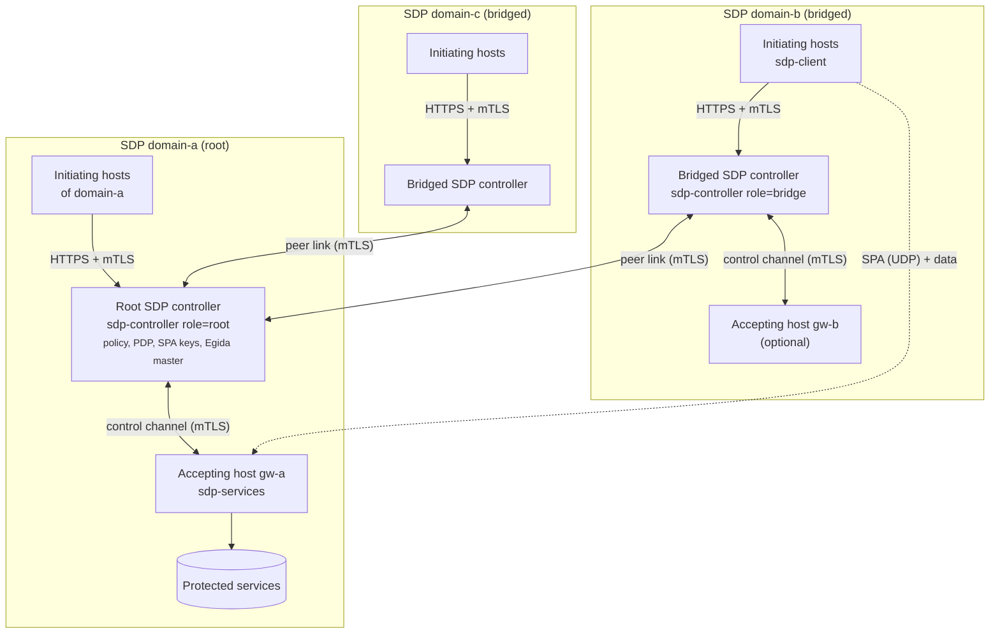
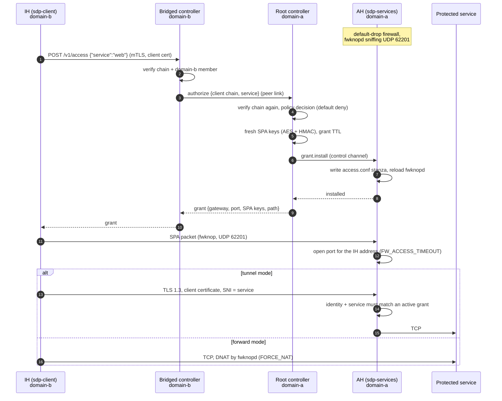
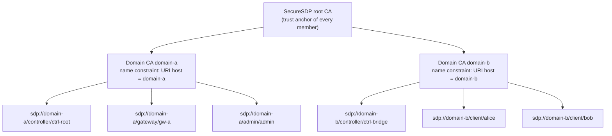

# Architecture

SecureSDP keeps the three SDP components defined by the Cloud Security Alliance (controller, initiating host, accepting host) and organizes the controllers following the **Bridge model**, which the paper selects for its scalability and cost after comparing it with hierarchical, web and mesh arrangements.

## Bridge model

- The **root controller** holds the policy of every domain (domains, accepting hosts, services, registered clients and their entitlements, hardening profiles). It is the only Policy Decision Point.
- Each **bridged controller** fronts its own domain: it authenticates the initiating hosts of that domain and the accepting hosts attached to it, and keeps a persistent peer link to the root. Members never talk to the controller of another domain, so each SDP keeps its topology.
- **Accepting hosts** connect to the controller of their domain. The root reaches accepting hosts attached to a bridge through that bridge's peer link, so authorizations and hardening commands follow the same path.

Controllers only relay authenticated requests: the root re-verifies the client certificate chain it receives from a bridge, and accepts it only if the client belongs to the bridge's own domain.

## Access sequence

The sequence below corresponds to Figure 5 of the paper (communication from a SecureSDP initiating host to an accepting host in the Bridge model), as implemented here.

Denied requests stop at step 4: the root answers `403` with the same message for unknown and forbidden services, so clients cannot enumerate the perimeter.

## Channels

| Channel | Ends | Transport | Purpose |
|---|---|---|---|
| Controller API | IH → controller of its domain (admin → root) | HTTPS, TLS 1.3, client certificate required | `whoami`, `services`, `access`; admin API on the root |
| Peer link | bridged controller ↔ root | persistent TLS 1.3 + bidirectional JSON RPC, keepalive, reconnect | relay of authorizations, service lists, attached accepting hosts, commands to them |
| Control channel | AH ↔ controller of its domain | same as the peer link | `gateway.sync`, `grant.install`, `grant.revoke`, `audit.run` |
| SPA | IH → AH | fwknop UDP packet (Rijndael + HMAC-SHA256) | opens the AH firewall for the IH address |
| Data (tunnel mode) | IH → AH → service | TLS 1.3 with client certificate, then TCP | data channel bound to the client identity |
| Data (forward mode) | IH → service | TCP DNATed by the AH | for services that cannot be tunneled |

Accepting hosts and bridged controllers dial out to their controller, so an accepting host needs no open inbound port besides what SPA opens.

## PKI: identities and the Bridge CA

- Every member certificate carries exactly one identity URI SAN `sdp://<domain>/<role>/<id>` with role `client`, `gateway`, `controller` or `admin`.
- The root CA only signs domain CAs. Domain CAs sign member certificates of their own domain only, and carry an X.509 `PermittedURIDomains` constraint, so even a misused domain CA key cannot mint a valid identity for another domain (covered by `TestNameConstraintEnforced`).
- Verification checks the chain up to the root **and** that the issuing domain CA is constrained to the identity's domain.
- Keys are ECDSA P-256. All TLS is 1.3. Servers authenticate clients by identity, and clients authenticate servers by identity (a pinned `controller_identity` or the expected role), not by host name.

`sdp-controller pki init` and `pki issue` create this hierarchy; the lab does it at start-up (`lab/pki-bootstrap.sh`).

!!! note "Relation to the Bridge CA of the literature"
    In the classic Bridge CA model, independent CAs are cross-certified through a bridge CA. SecureSDP uses a single root with name-constrained domain CAs, which gives the property the SDP needs (every member is verifiable by every controller, and a domain cannot speak for another) with a simpler PKI. Cross-certifying pre-existing domain roots would be a natural extension.

## Where each paper concept lives

| Paper | Implementation |
|---|---|
| Root SDP controller, central authentication and authorization | `internal/controller/root.go`, `internal/policy` |
| Bridged (hierarchical) controllers connected peer to peer | `internal/controller/bridge.go`, `internal/rpc` |
| IH authenticates with its bridged controller, which relays to the root | `Bridge.access` → `MethodAuthorize` → `Root.authorize` |
| Control and data channels protected by mTLS | `internal/pki/tls.go`, tunnel in `internal/gateway/tunnel.go` |
| SPA with fwknop, Debian, iptables | `internal/fwknop`, `internal/firewall`, Debian 12 `fwknop-server`/`fwknop-client` packages |
| Default inaccessible and invisible components | default-drop firewall + IPv6 drop on the AH |
| Controller as Egida master, AHs apply security controls | `gateway.sync` carries the hardening profile; `internal/hardening` |
| Controls chosen per service with Aspida | `policy.HardeningProfile` merges the profiles of the services an AH exposes |
| Lynis evaluation | `audit.run` and `sdp-controller admin audit` |
