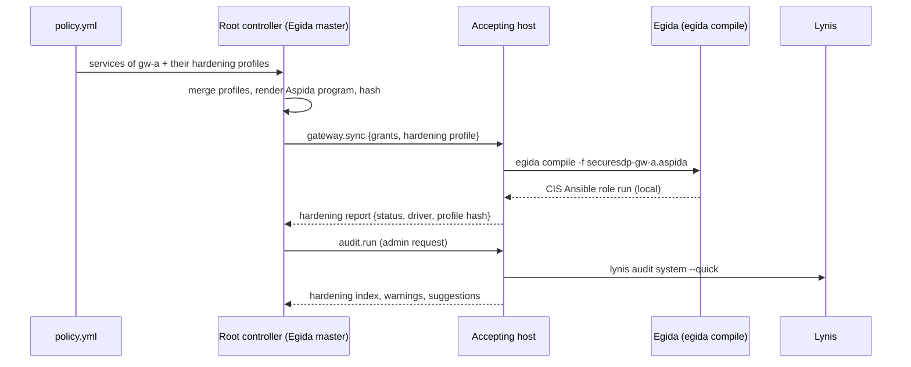

# Dynamic hardening

An SDP hides components from the network, but the components themselves (controllers, accepting hosts) still run general-purpose operating systems. The paper extends the Zero Trust model to each component with **dynamic hardening**: security controls are applied or withdrawn according to the services each accepting host exposes at a given time, without breaking those services. SecureSDP integrates [Egida](https://github.com/Egida-Kassandra/egida) for this ([Payá et al., Computers & Security 116, 2022](https://doi.org/10.1016/j.cose.2022.102638)).

## How it works



1. Each service in the policy lists the hardening profiles it needs; `defaults.hardening` applies to every accepting host.
2. When an accepting host connects, and after every policy reload, the root controller merges the profiles of the services that host exposes into one **Aspida** program (Egida's DSL). Exclusions from any profile win, so a service can veto controls that would interfere with it, which is the non-interference rule of Egida.
3. The program travels over the mTLS control channel (the controller plays Egida's *master* role; the accepting host is the *slave*).
4. The accepting host applies it with its `Hardener`:
    - `egida`: writes the program and runs `egida compile -f <file>`. Egida runs the CIS Ansible roles locally; they are idempotent, so already-applied controls are detected and skipped. SecureSDP also skips the run when the program hash has not changed.
    - `dry-run`: writes the program only. This is the driver of the Docker lab.
5. The result (`applied`, `unchanged`, `dry-run` or `failed`, plus the profile hash and Egida's output) is reported to the root and shown by `sdp-controller admin gateways`.

`sdp-controller admin profile gw-a` (or `sdp-controller policy aspida --policy policy.yml --gateway gw-a` offline) prints the program for an accepting host.

## Example program

The lab policy produces this program for `gw-a`, which exposes `web` (tunnel) and `web-nat` (forward):

```text
MAIN : {
    name: "securesdp-gw-a";
    connection: local;
    description: "SecureSDP dynamic hardening of accepting host gw-a (profiles: [sdp-accepting-host http-service], services: [web web-nat])";
}

HOST : "localhost";

TASKS : {
    sections: ["1.1", "1.6", "1.8", "2.2", "3.1", "3.2", "4.2", "5.2", "5.4", "6.1"];
    exclusions: ["2.2.10", "2.2.13", "3.1.2"];
}
```

The choices in the lab profiles illustrate the non-interference reasoning; they are examples, not a validated baseline:

- Section 3.5 (firewall configuration with `ufw`) is **not** selected: the accepting host firewall belongs to SecureSDP (iptables + fwknop) and enabling `ufw` would interfere with it.
- Point 3.1.2 (disable IP forwarding) is excluded because forward-mode services are DNATed through the accepting host.
- The `http-service` profile keeps CIS section 2.2 (special-purpose services) but excludes 2.2.10 (HTTP server) and 2.2.13 (HTTP proxy) so that a web service running on the host is not disabled.

The point numbers refer to the [Egida CIS role](https://github.com/Egida-Kassandra/egida-role-cis). Review them for your distribution before applying them to a real host.

!!! note "Withdrawing controls"
    The paper describes applying *and withdrawing* controls as the services of an accepting host change. SecureSDP re-derives and re-sends the program whenever the policy changes, and Egida applies what the new program selects. Egida's CLI does not undo a control that a previous program applied, so withdrawing a control currently means reverting it on the host (or re-provisioning it). This is a limitation of this implementation.

## Enabling Egida on a real accepting host

Egida needs a full Debian/Ubuntu host (systemd, Ansible) and root, so it is not used inside the lab containers.

1. Install Egida and its Ansible roles following the [Egida documentation](https://github.com/Egida-Kassandra/egida) (its `install.sh` installs Ansible, the `antonioalfa22.egida_role_setup` and `antonioalfa22.egida_role_cis` Galaxy roles and the `egida` binary, and configures a `local` host group).
2. Install `fwknop-server`, `iptables`, `conntrack` and `lynis` from the distribution, and the `sdp-services` binary.
3. Set the hardening driver in `services.yml`:

    ```yaml
    hardening:
      driver: egida
      egida: /usr/local/bin/egida
    ```

4. Run `sdp-services serve` as root (for example from a systemd unit). On the next sync the controller's program is applied; `sdp-controller admin gateways` shows `applied` or `failed`, and `sdp-controller admin harden gw-a` re-sends the state on demand.

!!! warning
    CIS hardening changes SSH, PAM, logging, kernel parameters and installed services. Test the profiles on a disposable VM, keep console access, and make sure the SSH variables (`sshd_access`, for example the port and allowed users the paper mentions) match how you administer the host.

## Auditing with Lynis

```bash
sdp-controller admin --config admin.yml audit gw-a
# Lynis 3.0.8 on gw-a: hardening index 55 (tests 226, warnings 1, suggestions 40, took 39s)
```

The accepting host runs `lynis audit system --quick --no-colors` with a private report file, parses `hardening_index`, `lynis_tests_done`, `warning[]` and `suggestion[]`, and returns them to the root controller, which keeps the last result per accepting host (`admin gateways`). If Lynis is not installed the report says so; no score is invented.

The figure above is from the lab container on the author's workstation: a minimal Debian 12 container is not comparable to the virtual machines the paper audited, and the lab does not apply Egida, so it is a starting point, not a result. The paper's before/after scores are summarized in [Evaluation](evaluation.md).
