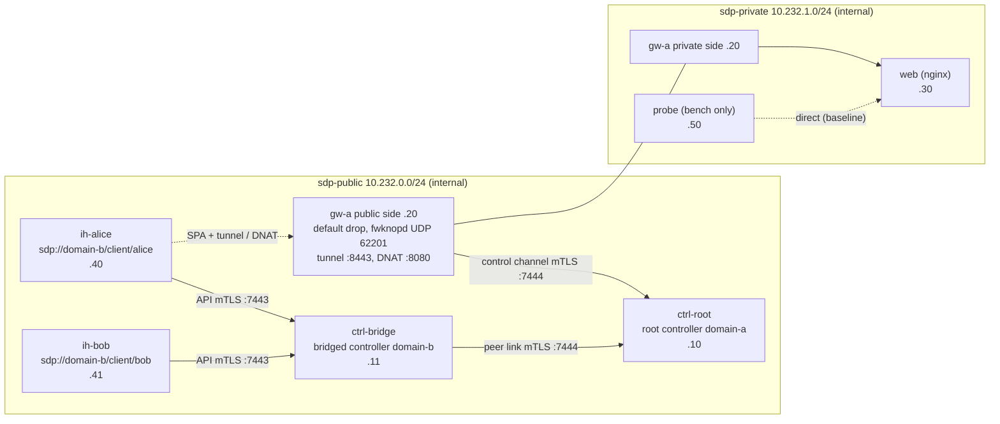

# Lab & demo

The Docker Compose lab runs a two-domain Bridge deployment on one machine. Nothing secret is committed: the PKI is generated by a one-shot `pki` container into a Docker volume on first start, and each container only mounts its own key.

## Topology



Both networks are `internal`: no container has a route to the Internet or to the host. nginx is only attached to the private network, so the accepting host is the only way in.

| File | Purpose |
|---|---|
| `docker-compose.yml` | services, networks, capabilities (`NET_ADMIN`, `NET_RAW` for the accepting host), health checks |
| `Dockerfile` | one Go build, three Debian 12 runtime targets: `controller`, `gateway` (fwknop-server, iptables, conntrack, Lynis), `client` (fwknop-client, curl) |
| `lab/pki-bootstrap.sh` | root CA, domain CAs and member certificates |
| `lab/config/policy.yml` | the root controller policy (services `web` in tunnel mode and `web-nat` in forward mode, clients alice and bob, hardening profiles) |
| `lab/config/*.yml` | controller, accepting host, client and admin configurations |

Controllers and initiating hosts run as an unprivileged user (uid 10001); the accepting host runs as root because it owns the firewall and sniffs SPA packets.

## The demo, step by step

`./scripts/demo.sh` runs these checks against the running lab and exits non-zero if any fails (it is the CI end-to-end test). It can run repeatedly: its last step revokes Alice's grants, which also closes what they had opened.

| Step | What happens | Expected |
|---|---|---|
| 1 | Alice probes `10.232.0.20:8080`, the tunnel port `8443` and nginx's private address | no answer: the accepting host drops everything and the private network is unreachable |
| 2 | `sdp-client whoami` and `services` | Alice is authenticated by `ctrl-bridge` (mTLS); her service list comes from the root |
| 3 | `sdp-client access web-nat --wait`, then `curl http://10.232.0.20:8080/` | the grant path is `bridge … -> root …`; HTTP 200 for Alice, still nothing for Bob |
| 4 | `sdp-client connect web --listen 127.0.0.1:PORT`, then `curl` the local port | HTTP 200 through the mTLS tunnel |
| 5 | Bob asks for `web` and `web-nat`, then probes the tunnel port | `access denied` (exit code 3) and the port stays filtered |
| 6 | Alice points her client at the root controller instead of her bridge | TLS handshake refused: domain-b members must use their own controller |
| 7 | `sdp-controller admin gateways` / `grants` | `gw-a` online, hardening profile synced (`dry-run`), Alice's grants listed |
| 8 | `sdp-controller admin revoke --client domain-b/alice` | the tunnel stops working immediately |
| 9 (optional, `RUN_AUDIT=1`) | `sdp-controller admin audit gw-a` | Lynis hardening index reported to the controller |

## Looking inside

```bash
# Firewall of the accepting host: default drop + rules opened by fwknopd
docker compose exec gw-a iptables -S
docker compose exec gw-a iptables -t nat -S FWKNOP_PREROUTING

# Per-grant access stanzas and the rendered Aspida program
docker compose exec gw-a cat /var/lib/sdp-services/access.conf
docker compose exec gw-a cat /var/lib/sdp-services/hardening/securesdp-gw-a.aspida

# Decisions and relays
docker compose logs ctrl-root ctrl-bridge | grep -E "authorization|relaying"
docker compose logs gw-a | grep -E "grant|tunnel|SPA Packet|access closed"
```

Policy changes take effect with a reload: edit `lab/config/policy.yml` (mounted read-only into `ctrl-root`) and run `docker compose exec ctrl-root sdp-controller admin --config /etc/sdp/admin.yml reload`.

## Troubleshooting

- **`docker compose up` fails on `subpath`**: update Docker Compose (volume `subpath` needs Compose 2.30+ and Docker Engine 26+).
- **Subnet conflict**: the lab uses `10.232.0.0/24` and `10.232.1.0/24`; change them in `docker-compose.yml`, `lab/pki-bootstrap.sh` (IP SANs), `lab/config/gw-a.yml` and `lab/config/policy.yml`.
- **HTTP 000 right after `access`** (without `--wait`): SPA is fire-and-forget over UDP; use `--wait`, or `connect` for tunnel services, which retries.
- **Logs**: `docker compose logs ctrl-root ctrl-bridge gw-a`.

## Benchmark

`./scripts/bench.sh [requests]` starts the `probe` container and prints response times for the four payload sizes, direct vs. forward vs. tunnel, plus the authorization round trip. See [Evaluation](evaluation.md) for what it measures and an example run.
